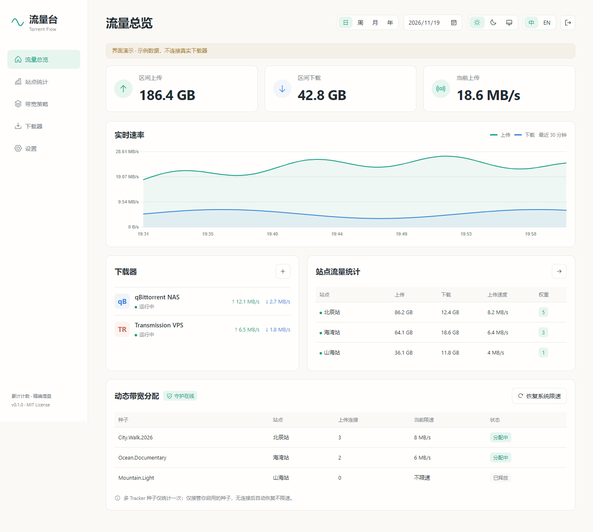

# 流量台 · Torrent Flow

面向个人 NAS 的 qBittorrent / Transmission 流量统计与上传带宽管理工具。浅色、深色、跟随系统，简体中文 / English，支持手机、平板和桌面。

界面配色与图标风格参考 Uptime Kuma，保留流量统计自身布局；不使用其标识，与该项目无从属关系。

支持通过普通局域网 HTTP 地址添加下载器、站点和带宽池；不依赖仅 HTTPS/localhost 可用的浏览器 UUID API。宽屏主区域在侧栏右侧空间内居中，保留适量两侧留白。



## Docker 部署

下载本仓库 `compose.yaml`，在该目录运行：

```sh
docker compose up -d
```

打开 `http://你的主机:28188`，账号为 `admin`。首次启动自动生成密码，只写入数据目录：

```sh
docker exec torrent-flow cat /data/initial-password.txt
```

登录后在设置中修改密码，并删除此初始密码文件。也可以首次启动设置 `ADMIN_PASSWORD`，要求 12–72 字节，包含大小写字母、数字、符号；已存在账户时不会通过环境变量重置。不要把真实密码写进公开 Compose 或 Git。

镜像会准备挂载目录后降权为 UID/GID 10001，普通可写 Docker 绑定目录或 named volume 即可。无需另外创建 data-init 服务。若显式指定 `user:` 或挂载为只读，需要自行授予该用户写入数据目录的权限。

默认部署两个容器：主程序负责界面/统计/调度，独立 guardian 只负责主程序掉线后的限速恢复，不是初始化容器。按最新恢复要求，主容器停止期间也需要解除系统限速，因此默认配置 `EXTERNAL_GUARDIAN=true`。二者共享同一个 data 目录，不需要外部数据库、Redis 或额外初始化服务。守护、下载器或主机也不可达时，仍需等待连接恢复。

不要把下载器的 WebUI 暴露到公网。访问地址必须从容器内部可达；Transmission 可填 `http://nas:9091` 或完整 RPC 地址；常见 `/transmission/web/` 地址会自动转换为 `/transmission/rpc`。同主机的 RPC 重定向保留 POST 和会话协商，跨主机/端口跳转会拒绝携带凭据，需明确填写最终 RPC 地址。测试按钮使用当前表单，密码留空则使用已有保存值，不要求先保存。

升级时保留原 data 目录和原部署位置，用当前 `compose.yaml` 更新两个服务，执行 `docker compose pull`、`docker compose up -d`。不要使用 `down -v`。0.1.1/0.1.2 用户更新时会重新加入独立守护；原有双容器用户沿用这两个服务即可。

## 使用顺序

1. 下载器 → 添加 qBittorrent 或 Transmission，先测试连接再保存。默认只读采集，不更改下载器。
2. 站点统计 → 自动从下载器发现 Tracker 域名，不用先录入规则；点击站点修改名称。同域名不同路径/passkey 自动归为同一站点。高级场景仍可设置多个域名别名和 RE2 正则，界面不会显示 passkey。
3. 观察统计。首次接入的旧累计值建立基线，不记为今日新增。日/周/月/年按所选时区汇总，保留最近一年。
4. 需要自动调速时，先添加带宽池，给同一出口的下载器选择该池。设置站点权重、最低额度、最高额度，确认守护在线后开启带宽池。
5. 下载器设置 → 开启“自动接管活跃种子”，此下载器已有和未来的活跃种子自动参与带宽池分配，无需逐个勾选；默认关闭，开启之前不会写入限速。单个种子可以明确排除，也可保持原来的逐个接管方式。每个种子只有一个限速，不会因为多个 Tracker 重复计量。

总览的“动态带宽分配”仅显示正在接管且有上传连接的种子，种子名称下显示去除敏感路径的 Tracker 域名。完整列表在站点统计、带宽策略中查看；可搜索种子名称或 Tracker 域名。首个带宽池默认关联尚未分组的下载器；新增下载器在只有一个池时默认选中该池，不同出口需手动另建池。

有上传连接的种子参与动态分配。最低额度后按权重分配剩余额度；无连接持续超过释放延迟后恢复种子不限速。实际速度受其他 peer 需求影响，额度不代表实际速度。qBittorrent 使用连接的 leechers 判断需求；Transmission 使用正在接收/感兴趣的 peer，按客户端公开字段作近似判断，不保证严格的网络层公平排队。

日/月上传目标是软目标：达到后转为非零低速额度，不暂停种子。不能同时保证绝对不超目标和保持持续上传。下载器全局限速、排队设置保持不变，站点规则仍由使用者自行确认。

## 断线与恢复

- 正常关闭、关闭调速、解除接管、无连接：只解除系统接管的种子限速，其他个人限速不变。
- 默认独立 guardian：即使主容器停止，仍可在心跳超过约 30 秒后恢复限速；恢复失败保留队列重试。
- 非 Docker 开发仍可使用内置恢复；整个进程停止时无法运行，仅在重启后对账。
- 网络中断、下载器或整台主机也关机、守护同时停止：无法远程修改下载器，待重新可达后继续恢复。若同时关闭两个服务，独立守护也无法继续恢复。
- 用户在下载器手动改了被接管种子的限速：退出接管、记录外部修改，避免覆盖。
- 页面“恢复系统限速”会关闭带宽池并解除系统限速，不是清空所有下载器限速。

限速命令前持久化旧值与计划值，网络写入后读回验证；恢复任务与控制器通过 SQLite 写事务串行化命令。轮询和客户端 API 都有延迟，因此预算是软件调度目标，不是网络层硬上限。

## 统计口径

种子以“下载器实例 ID＋infohash”标识，累计计数器差分计量，不用速率乘时间。多个 Tracker 的种子只有一份统计；跨实例相同 hash 的两次传输分别计量。自动发现的多 Tracker 种子默认按下载器返回的第一个 Tracker 归属；明确指定的单种子归属优先，唯一的手动站点规则优先于自动规则。多个手动站点规则互相冲突时仍需明确选择归属，避免静默更改已配置的统计口径。

删除种子不删除历史流量。计数器回退或重新添加建立新基线；不能还原客户端已经丢失的计数。长时间离线后能补记累计增量，但无法精确还原每个字节的时间，相关报表明确标注不确定区间。更改站点规则不重写既有历史，之后增量采用新的归属。

## 推荐默认参数

| 参数 | 默认 / 推荐 | 作用 |
|---|---|---|
| 站点识别 | 自动 | 按 Tracker 主机名归类，忽略路径/passkey；名称可修改 |
| 站点权重 | 1 | 活跃站点平分剩余额度；3 对 1 为约三倍的剩余额度 |
| 最低额度 | 0 | 不提前保留带宽，避免空闲站点或大量站点占满最低额度 |
| 最高额度 | 0 | 不额外封顶，仍受总带宽池预算约束 |
| 日 / 月上传目标 | 0 | 默认关闭；需要达标降速时再开启 |
| 达标后额度 | 0.05 MiB/s | 开启目标后生效，保持非零上传，不暂停种子 |
| 采样间隔 | 5 秒 | 及时统计和调度；大量种子可用 10–15 秒降低 API 负载 |
| 无连接释放延迟 | 15 秒 | 避免连接抖动造成频繁写限速，持续闲置后释放 |
| 新带宽池预算 | 1 MiB/s，默认关闭 | 可编辑示例，必须按真实出口带宽确认，系统无法自动测准 |
| 下载器自动接管 | 默认关闭，确认预算后开启一次 | 已有/新出现的活跃种子自动参与，单种子排除优先 |

原有手动规则、权重和接管选择保持不变，不会自动重置成推荐值。没有 Tracker 的种子仍标记未分类。

## 总上传 1M 怎么配置

参见 [1 MiB/s 总预算配置说明](docs/UPLOAD-1M.md)，含两个下载器、两个站点、3:1 权重、最低额度和启用步骤。1 Mbps 上行与 1 MiB/s 不是同一单位。

## 占用与采集优化

- 同一种子、站点、小时内的累计增量合并存储，上传/下载总量保持不变，不再每 5 秒新增一条永久记录。旧数据继续读取，不清空数据库。
- 实时速度最多每 15 秒记录一次，保留 24 小时；未连接下载器时不写空速度记录。
- 保留期清理最多每小时一次；Tracker 列表缓存两分钟。
- 内存、CPU 和磁盘增长与下载器数量、种子数量、活跃种子比例有关，空载测试不代表大规模负载。

## 数据与安全

SQLite 数据库和 `master.key` 必须一起保留，连接配置通过 AES-GCM 加密保存。登录使用密码哈希、HttpOnly/SameSite Cookie、CSRF 令牌、登录频率限制。应用只供部署者个人使用，没有公开注册。

管理员主动配置的内网下载器需要服务端发起请求；此功能允许访问内网，不能把后台账号交给不可信用户。普通请求不跟随跳转；TR RPC 仅允许有限次数同源跳转（或同主机安全升级到 HTTPS），不会将凭据转发到另一主机或任意端口。建议内网使用或通过 HTTPS 反代，并设置 `COOKIE_SECURE=true`。

备份前先通过界面关闭调速并确认恢复队列为空，再停止服务，复制完整 `data/` 目录。在其他位置挂载该完整目录即可恢复；不要只复制正在写入的 SQLite 主文件。不要公开分享数据库、密钥、初始密码或连接设置。删除 `master.key` 不能重置密码，只会让连接密文无法解密。

## 开发

Go 1.26+，Node 24+：

```sh
cd frontend
npm ci
npm run build
cd ..
go test ./...
go build -o torrent-flow .
./torrent-flow
```

独立恢复守护：`./torrent-flow --guardian`，共享相同 `DATA_DIR`。默认监听 `:8080`，可通过 `LISTEN_ADDR` 修改。前端演示 `/?demo=1` 为明确标注的示例模式，不访问真实下载器，也不修改真实配置。

## License / 致谢

MIT。功能调研参考 [torrent-traffic-monitor](https://github.com/ystykxc/torrent-traffic-monitor)，视觉参考 [Uptime Kuma](https://github.com/louislam/uptime-kuma)，本项目独立实现；下载器适配依据 [qBittorrent WebUI API](https://github.com/qbittorrent/qBittorrent/wiki/WebUI-API-%28qBittorrent-5.0%29)、[Transmission RPC](https://github.com/transmission/transmission/blob/main/docs/rpc-spec.md)。依赖的 React、Chart.js、Font Awesome、Go x/crypto 与 modernc SQLite 保留各自上游授权。详见依赖清单及 lock 文件。

---

**English:** Personal, self-hosted traffic accounting and upload-budget control for multiple qBittorrent / Transmission instances. Counters are measured per torrent, not per tracker; site aliases are grouped without duplicate accounting. Start the Compose stack, read the generated initial password locally, connect downloaders, configure site rules and optionally enable guarded bandwidth allocation. Control requires per-torrent opt-in or one explicit downloader-wide automatic opt-in; individual exclusions take precedence. The default deployment uses a main container and an independent guardian so recovery can continue while the main container is stopped. No recovery can run while the responsible worker or downloader is unreachable. Keep the entire data directory, including the encryption key, when migrating.
